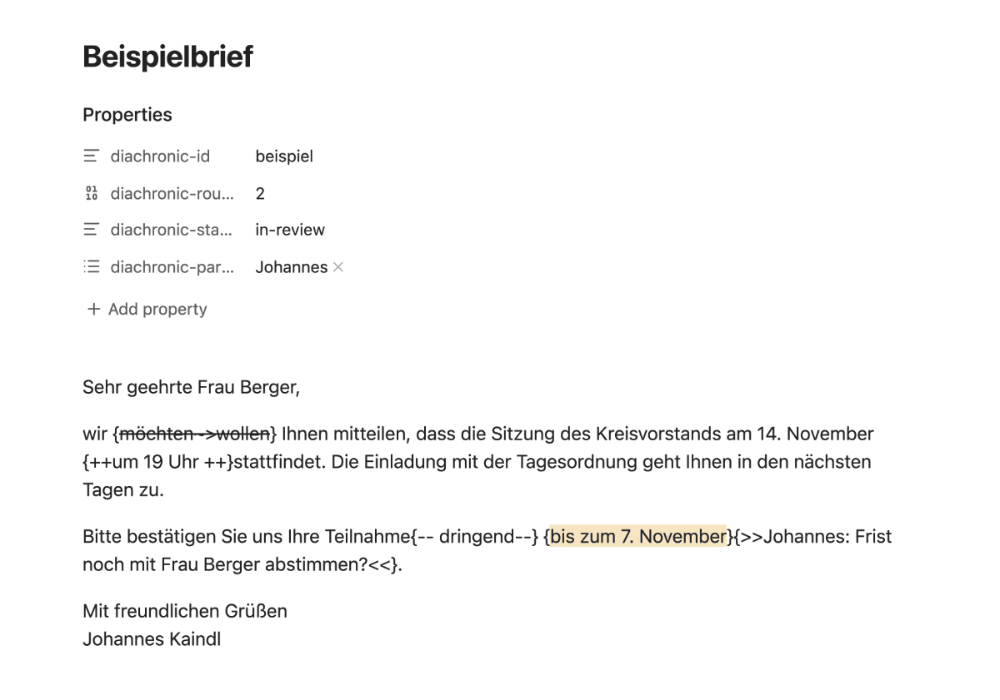

# Why CriticMarkup

The suggestions are written as [CriticMarkup](https://criticmarkup.com/), an open convention for tracked changes in plain text. Three reasons:

- **The file stays readable without the plugin.** Whoever receives the note without Diachronic sees `{~~möchten~>wollen~~}` between the words: noisy, but nothing is lost and nothing needs to be installed.
- **Other tools read it.** Several Obsidian plugins and Markdown editors understand the same marks. Diachronic does not depend on any of them, and it does not rely on how they treat the extra data in the hidden block; the marks themselves are the standard five forms only.
- **No hidden state in the marks.** Author, time and state live in the hidden block, not in the marks. A mark can be copied, quoted or edited by any tool without breaking.

This is how the example letter looks in Obsidian's reading view: the hidden block does not show, and the marks stay in the text as plain characters.

wollen~~} and a comment in double angle brackets">

CriticMarkup has no escapes and no nesting. Diachronic therefore never writes a mark around text that contains one of the closing sequences, never nests a comment into a change, and refuses a change that would touch an existing mark instead of merging it silently.

A word on colour: the kind of a change always shows by form (insertion underlined, deletion struck through), so it also reads for people who cannot tell red from green. Colour by author is an option, off by default.
