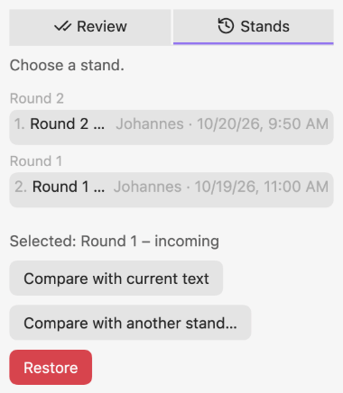

# Restore or compare a stand

Open the review sidebar and switch to **Stands**. The stands of the active note are listed by round, newest first.

- **Compare with the current text:** choose a stand, then *Compare with current text*. The comparison reads the text without properties and block, with suggestions read as accepted and without comments, deleted words struck through and inserted words underlined.
- **Compare two stands:** choose one, *Compare with another stand…*, choose the second.
- **Restore:** choose a stand, *Restore*, confirm. The current text is saved as a stand first ("Before restore"), so nothing is lost. If you restore an incoming or a marked stand, it also becomes the base for the next *Mark changes*.

If a stand cannot be read (damaged file, broken chain), a notice names it; the other stands stay usable.
